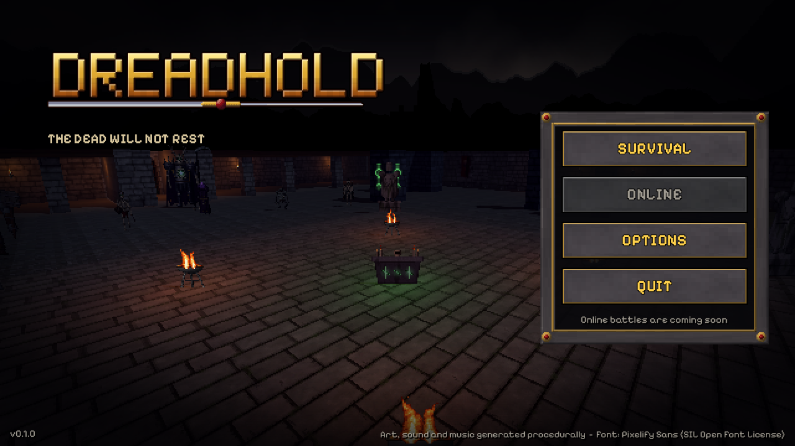
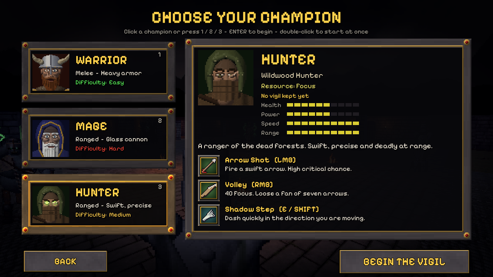
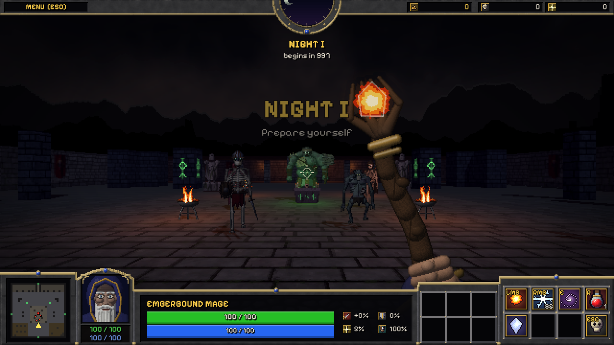
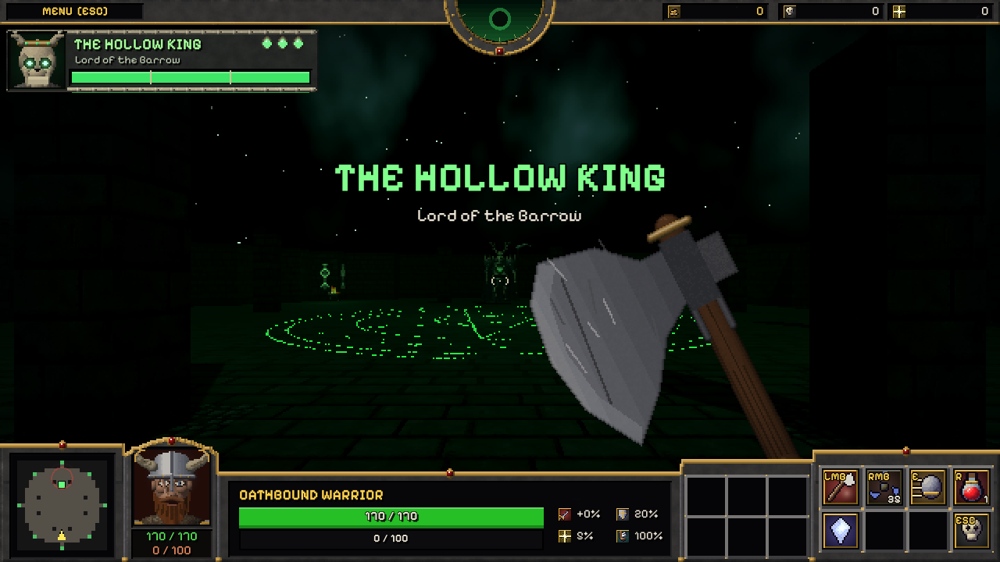
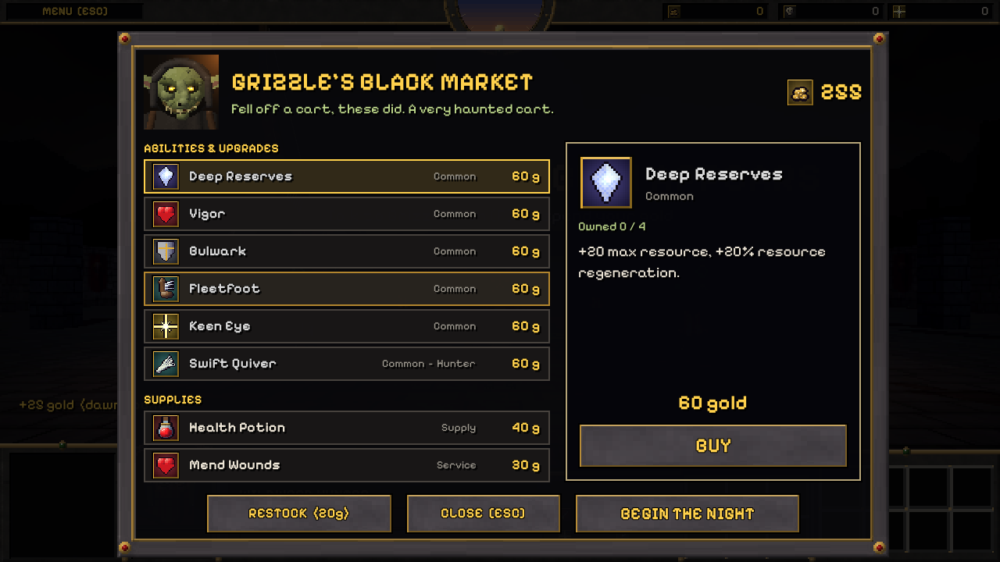
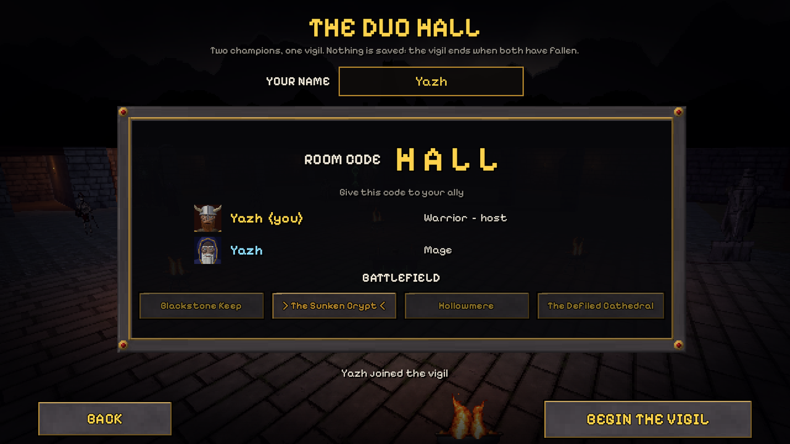
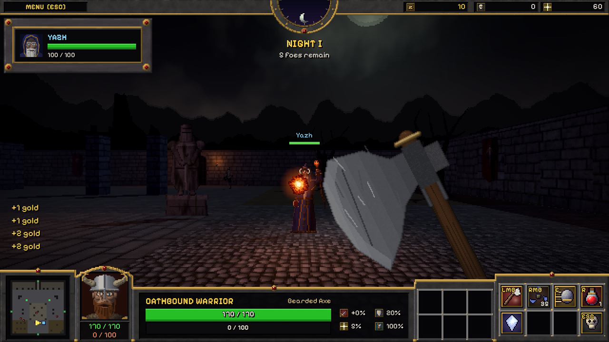

<div align="center">

# DREADHOLD

**A dark-fantasy, Doom-style first-person survival game — swords, sorcery and bows, no guns.**

*The dead will not rest.*




### [▶ Play in your browser](https://dreadhold.vercel.app)

</div>

---

Dreadhold is a retro first-person game in the spirit of the early-90s classics, crossed with the
dark high-fantasy feel of classic real-time-strategy games. You defend a fallen keep, night after night,
against an endless horde of undead. Between nights, a shady goblin sells you power for the gold of the
dead, and every fifth night you are dragged into a ritual arena to face one of four bosses.
Hold the line alone, or **online with an ally** in a duo vigil, in the desktop app or in the browser.

**Every visual, sound and music track is generated procedurally by code in this repository**
(textures, sprites, first-person weapons, portraits, UI, sound effects, music). The only third-party
asset is the [Pixelify Sans](https://github.com/eifetx/Pixelify-Sans) font (SIL Open Font License).

## Play

- **In the browser**: [dreadhold.vercel.app](https://dreadhold.vercel.app), on any recent desktop browser
  (Chrome, Edge, Firefox). Click into the game to capture the mouse; `Esc` releases it and pauses.
- **From source**: see *Getting started* below.

## Screenshots

| Champion selection | Fighting the night |
|---|---|
|  |  |

| The Barrow Throne | Grizzle's Black Market |
|---|---|
|  |  |

| The Duo Hall | A duo vigil |
|---|---|
|  |  |

## Features

- **Doom-style FPS feel**: fast movement, billboard sprite enemies, chunky pixel rendering
  (the 3D world renders at 640×360, while the UI stays sharp at 1280×720).
- **Three champions**, each with its own resource and kit (see below), and **weapon upgrades**: every boss
  slain grants the next weapon tier, shown in hand (Bearded Axe → Reaver Greataxe → Doomcleaver,
  Ember Staff → Moonsilver Staff → Staff of the Burning Eye, Yew Longbow → Hornbow of the Wilds → Wyrmbone Greatbow).
- **Four battlefields** to choose from:
  - *Blackstone Keep*: a moonlit courtyard;
  - *The Sunken Crypt*: a vaulted ossuary of corridors and tombs;
  - *Hollowmere*: a misty ruined village;
  - *The Defiled Cathedral*: a dark nave cut by a rood screen and walled chapels.
- **Survival mode, "The Vigil"**:
  - **Nights**: each one is a wave of ghouls, skeletons, bone archers, shadow acolytes and barrow brutes.
  - **At dawn**, *Grizzle the black-market goblin* appears. Trade with him to buy abilities and upgrades, potions or healing (and an off-hand torch for warriors), or restock his wares.
  - **Every 5th night**, you are teleported into a boss arena. The four bosses take turns, and later cycles bring them back stronger. Each boss has three phases: every shattered phylactery makes it angrier.

    | Boss | Arena | Signature attacks |
    |---|---|---|
    | The Hollow King | The Barrow Throne | raises the dead, soul volleys |
    | Mother of Rot | The Rotting Pit | acid rain that leaves toxic pools, ghoul broods |
    | The Cinder Tyrant | The Molten Forge | meteor strikes, a shockwave you must jump over |
    | Lady Rime | The Frozen Sanctum | blinks around you, ice volleys, a frost nova that slows |
- **Duo vigils (online co-op)**: open a room in *the Duo Hall* and give its four-letter code to an ally,
  who joins from the app or the browser. Nothing is saved; the waves grow to match two champions.
  - Each champion loots its own gold and shops for itself at dawn; the night falls once both are ready.
  - A fallen champion is **down, not dead**: hold `F` next to them for 3 seconds to raise them, or they rise
    at dawn. The vigil ends when both are down.
  - Your ally is drawn as a full champion sprite, with a frame, a name tag and a minimap marker.
- **Soundtrack and ambience**: the night music grows heavier every five nights, each boss has its own theme,
  dawn has the goblin's market tune, and every battlefield has its own looping ambience bed.
- **RTS-inspired console HUD**: minimap with spawn pings, living portrait, and a command card with hotkeys and radial cooldowns. A night dial shows the night's progress, and a boss plate tracks the boss's phylacteries.
- **Score screen** on defeat, with Overview, Combat and Upgrades tabs and comparisons to your personal bests.
- **Procedural everything**: the generators live in `tools/` and can be re-run at any time.

## Champions

| Champion | Resource | Left click | Right click | E / Shift |
|---|---|---|---|---|
| **Warrior**: melee, heavy armor | Rage | Cleave | Reaving Spin | Iron Charge |
| **Mage**: ranged, glass cannon | Mana | Fireball | Frost Nova | Blink |
| **Hunter**: ranged, swift | Focus | Arrow Shot | Volley | Shadow Step |

## Controls

| Action | Key |
|---|---|
| Move | `W A S D` (physical keys, so `Z Q S D` on AZERTY) / arrows |
| Jump | `Space` |
| Primary / secondary ability | `Left` / `Right mouse` |
| Utility ability | `E` or `Shift` |
| Drink a potion | `R` |
| Talk to the goblin / raise a fallen ally (hold) | `F` |
| Pick champion / battlefield | `1`–`4`, `Enter` |
| Pause menu | `Esc` |

## Getting started

1. Install **[Godot 4.6](https://godotengine.org/download/)**. The project is pure GDScript, so no .NET is required.
2. Clone the repository and open `project.godot` in Godot. The first import takes a few seconds.
3. Press **F5**.

To try a duo vigil on one machine, run the game twice (**Debug > Customize Run Instances** in the editor,
or two exported copies): open a room in the first, join with its code in the second.

## Regenerating the assets

The art is produced by headless Godot scripts:

```sh
tools/run_tool.sh res://tools/gen_art.gd 600    # textures, enemies, champions, props, effects, weapons, portraits, NPCs
tools/run_tool.sh res://tools/gen_ui.gd 300     # console HUD, frames, icons, logo, cursor, boss plate
```

The audio (sound effects, music, ambiences, all OGG Vorbis) comes from a Python generator
(numpy/scipy/soundfile) that runs in a project-local virtual environment:

```sh
py -3 -m venv .venv
.venv/Scripts/python -m pip install -r tools/audio/requirements.txt
.venv/Scripts/python tools/audio/gen_audio.py                       # everything
.venv/Scripts/python tools/audio/gen_audio.py --only fireball_cast  # a subset (--list shows every name)
```

`run_tool.sh` runs the script with a hard timeout. The generators also write contact sheets to
`tools/preview/` for quick visual checks (that folder is git-ignored).

## Testing hooks

The game accepts a few command-line flags (after `--`) that are used for automated checks:

```sh
godot --path . -- start class=mage demo                # start a run with a line-up of enemies
godot --headless --path . -- start bot log god wave=4   # an autopilot plays and logs every night
godot --path . -- start dawn shop gold=250              # open the black market directly
godot --path . -- start shot=out.png shot_at=3 quit_at=4

# duo, against a local relay (see below): two autopilots play together
godot --headless --path . -- duo=host code=TEST relay=ws://127.0.0.1:8791 autostart bot log
godot --headless --path . -- duo=join code=TEST relay=ws://127.0.0.1:8791 bot log
```

## Online play: the relay

Duo vigils need no port forwarding. Both players open a WebSocket to a tiny relay
(`server/relay`, a Cloudflare Worker with one Durable Object per room code) that forwards packets between
them, so the browser and the desktop app can play together. The host's machine runs the vigil (waves,
enemies, bosses) and streams snapshots to its ally; each machine runs its own champion, loot and shop.

```sh
cd server/relay
npm install
npm run dev           # local relay on ws://127.0.0.1:8791
npm test              # smoke test (host, join, forward, refusals, leaving) against the local relay
npx wrangler deploy   # publish (after a one-time "npx wrangler login")
```

## Web build

Every push to `main` runs the **Web build** workflow (`.github/workflows/deploy-web.yml`): it installs
Godot 4.6 and its web export templates, exports the game with the Compatibility renderer and keeps the
build as an artifact. When the `VERCEL_TOKEN`, `VERCEL_ORG_ID` and `VERCEL_PROJECT_ID` repository secrets
are set, it also publishes the build on Vercel.

## Project layout

```
scripts/
  autoload/        Game (settings, input map, records, theme, cursor) and Sfx (audio)
  net/             duo session: the relay peer and every online message
  world/           grid-built arenas (battlefields and boss arenas), the goblin, pixelated world view
  player/          first-person controller, class kits, and the ally as seen online
  enemies/         data-driven enemy AI (flow-field navigation, pain states, boss phases, online puppets)
  combat/          projectiles, hazards, effects, loot
  modes/           survival director (nights, dawn market, boss teleport, duo)
  ui/              HUD widgets, menus, Duo Hall, black market, score screen
  data/            classes, enemies, bosses, maps, weapons, boons
server/relay/      the duo relay (Cloudflare Worker)
tools/             procedural generators for art, UI (GDScript) and audio (Python)
assets/            generated assets (+ the OFL font)
web/               hosting headers for the web build
docs/screenshots/  images for this README
```

## Roadmap

- [x] Online duo vigils (2-player co-op), in the app and in the browser
- [ ] Desktop releases (Windows, Linux) on GitHub
- [ ] More champions and more abilities per class
- [ ] More enemy types and bosses, more arenas
- [ ] Controller support
- [ ] Settings for key rebinding and graphics

## Contributing

Development happens feature by feature, with one focused commit per feature or fix, using
[Conventional Commits](https://www.conventionalcommits.org/) prefixes (`feat:`, `fix:`, `art:`, `docs:`, `refactor:`).

## Credits & licenses

- Game code, procedural generators and all generated art, sound and music: the Dreadhold authors.
  No open-source license has been chosen for these yet, so all rights are reserved for now.
- Font: **Pixelify Sans**, © The Pixelify Sans Project Authors, licensed under the
  [SIL Open Font License 1.1](assets/fonts/ofl/PixelifySans-OFL.txt).
